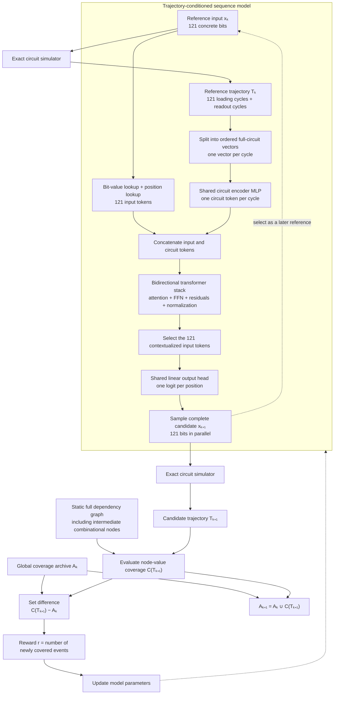

The planned model is a trajectory-conditioned, parallel 121-bit generator. It receives one complete evaluated input and its full circuit trajectory, then proposes another complete input. The dependency graph and global archive remain outside the model and produce the reward.



## 1. Reference data

The reference input is:

\[
x_k\in\{0,1\}^{121}
\]

The exact simulator produces:

\[
T_k\in\{0,1\}^{T\times N}
\]

where:

- \(T=121+\text{readout cycles}\).
- \(N\) is the number of recorded circuit variables.
- Every row uses exactly the same variable ordering.
- Loading and readout cycles are marked by phase.

The trajectory contains actual circuit values, not learned state estimates.

## 2. Puzzle-input tokens

For each input position \(i\):

\[
q_i=
E_{\text{bit}}[x_{k,i}]
+
E_{\text{position}}[i]
+
E_{\text{input-type}}
\]

Shapes:

```text
bit embedding:       [2, d_model]
position embedding:  [121, d_model]
resulting tokens:    [121, d_model]
```

No input encoder MLP is required. The trainable lookup matrices directly produce the tokens.

## 3. Circuit-cycle tokens

For cycle \(t\), convert the ordered Boolean circuit vector to signed values:

\[
\tilde S_t=2S_t-1
\]

Then:

\[
c_t=
\operatorname{LayerNorm}\left(
\operatorname{MLP}_{circuit}(\tilde S_t)
+
E_{\text{cycle}}[t]
+
E_{\text{phase}}[t]
+
E_{\text{circuit-type}}
\right)
\]

The same circuit MLP is reused for every loading and readout cycle:

```text
N circuit values
→ hidden width
→ d_model
```

This produces:

\[
C\in\mathbb{R}^{T\times d_{\text{model}}}
\]

## 4. Transformer context

Concatenate the two token sequences:

\[
H_0=[q_0,\ldots,q_{120},c_0,\ldots,c_{T-1}]
\]

Shape:

\[
[121+T,\ d_{\text{model}}]
\]

The reference context is completely known, so attention is bidirectional. Physical circuit causality does not require a causal mask: the model is analyzing downstream results specifically to revise their upstream causes.

Each pre-normalized transformer block is:

\[
H\leftarrow H+
\operatorname{MultiHeadAttention}(\operatorname{Norm}(H))
\]

\[
H\leftarrow H+
\operatorname{FFN}(\operatorname{Norm}(H))
\]

Thus every block already includes:

- Multi-head attention.
- Residual connections.
- Normalization.
- Nonlinear FFN processing.

Learned absolute input and cycle positions are sufficient initially. RoPE is not part of the first model.

## 5. Parallel 121-bit output

After the final transformer block, retain the contextualized vectors corresponding to the original 121 input tokens:

\[
h_0,\ldots,h_{120}
\]

Apply one shared output head:

\[
\ell_i=w^\top h_i+b
\]

\[
p_i=\sigma(\ell_i)
\]

During training, sample:

\[
x_{k+1,i}\sim\operatorname{Bernoulli}(p_i)
\]

All 121 positions are produced in parallel. There is:

- No output decoder.
- No autoregressive bit generation.
- No circuit simulation between generated bits.
- No causal attention mask.

The result is one concrete, independently replayable 121-bit sequence.

## 6. Evaluation and reward

Exact replay produces the candidate coverage set:

\[
C(T_{k+1})
\]

Single-rollout coverage is recorded:

\[
L_{k+1}=|C(T_{k+1})|
\]

but it is not the reward.

The reward is global coverage gain:

\[
r_{k+1}
=
|C(T_{k+1})\setminus A_k|
\]

Then:

\[
A_{k+1}=A_k\cup C(T_{k+1})
\]

Neither the static dependency graph nor the global archive is currently supplied to the model:

- The graph defines which trajectory events count as coverage.
- The archive determines which covered events are genuinely new.
- The model sees only the reference bits and reference trajectory.

## 7. Training interface

The model defines a probability for its complete proposal:

\[
\log\pi_\theta(x_{k+1}\mid T_k,x_k)
=
\sum_{i=0}^{120}
\log\operatorname{Bernoulli}(x_{k+1,i};p_i)
\]

A baseline policy-gradient loss would be:

\[
L_{\text{policy}}
=
-(r_{k+1}-b)
\log\pi_\theta(x_{k+1}\mid T_k,x_k)
\]

where \(b\) reduces reward variance. The exact training method—policy gradient, elite imitation, or a bootstrapped combination—remains the main unresolved component.

The architectural contract itself is settled:

```text
reference bits + exact reference trajectory
→ learned vector tokens
→ bidirectional transformer
→ parallel complete 121-bit proposal
→ exact replay
→ global coverage-gain reward
```
